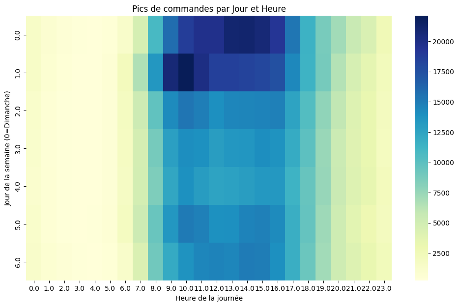
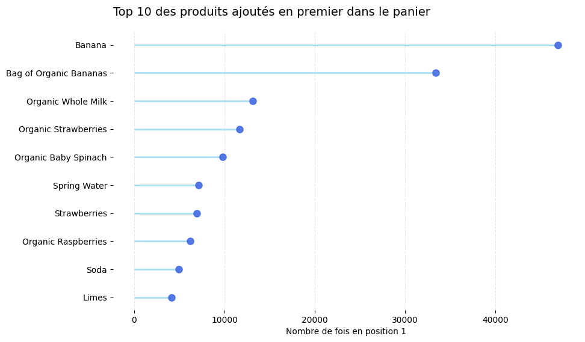
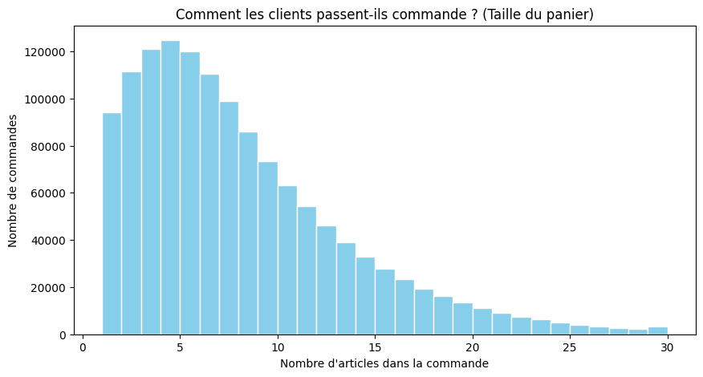
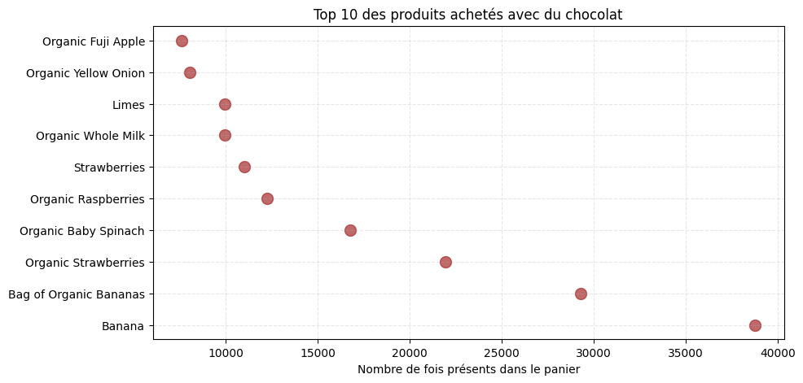
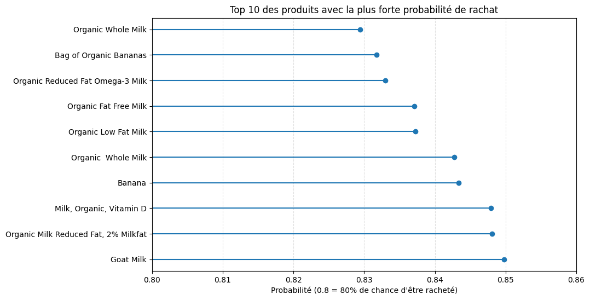
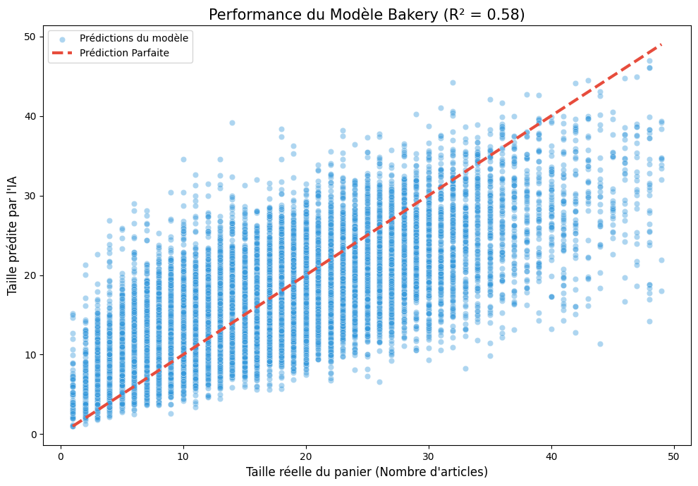

<div align="center">

# 🛒 NEXTBUY — de la donnée brute aux décisions business

**Analyse de millions de lignes de commandes d'un supermarché en ligne : 12 questions business, un modèle de prédiction et une boutique avec recommandations.**




<sub>Quand les clients commandent : pics le dimanche et le lundi, entre 9 h et 16 h.</sub>

</div>

---

## 🎯 En bref

Une enseigne de grande distribution veut comprendre ses clients pour **augmenter son chiffre d'affaires,
mieux cibler son marketing et organiser sa logistique**. Le projet suit tout le parcours d'un data analyst :

| Étape | Livrable |
|---|---|
| 🧹 **Nettoyage** | 5 tables fusionnées (produits, rayons, départements, commandes, lignes de commande), doublons et colonnes inutiles retirés → [`notebook.ipynb`](notebook.ipynb) |
| 📊 **Analyse** | 12 questions business, chacune avec un graphique, une analyse et une **réponse business** → [`notebook_graph.ipynb`](notebook_graph.ipynb) |
| 🤖 **Modèle** | Prédiction de la taille d'un panier (Random Forest) → [`modele.ipynb`](modele.ipynb) |
| 🛍️ **Application** | Boutique Streamlit qui recommande des produits achetés ensemble (k plus proches voisins) → [`yanis/app.py`](yanis/app.py) |

GitHub affiche les notebooks **avec leurs graphiques** : cliquez sur un lien pour voir l'analyse complète.

---

## 🔍 Ce que disent les données

<table>
<tr>
<td width="50%"></td>
<td width="50%"></td>
</tr>
<tr>
<td><b>La banane ouvre le panier.</b> C'est de loin le produit ajouté en premier : un produit d'appel idéal
à mettre en avant en page d'accueil.</td>
<td><b>Des petits paniers.</b> La plupart des commandes contiennent entre 3 et 8 articles : il y a de la marge
pour la vente croisée.</td>
</tr>
<tr>
<td></td>
<td></td>
</tr>
<tr>
<td><b>Le chocolat part avec des fruits.</b> Bananes, fraises et épinards bio sont les plus souvent dans le même
panier : une piste pour des offres groupées.</td>
<td><b>Le lait fidélise.</b> Les laits (bio, de chèvre, demi-écrémé) sont rachetés dans plus de 83 % des cas :
des produits à ne jamais laisser en rupture.</td>
</tr>
</table>

<details>
<summary><b>📋 Les 12 questions traitées</b></summary>

<br>

1. Quels sont les produits les plus vendus ?
2. Quel article les clients mettent-ils en premier dans leur panier ?
3. Quels sont les rayons qui ont le plus de produits ?
4. Quels sont les rayons qui ont le moins de produits ?
5. Quelle est la proportion de légumes bio dans les commandes ? *(25 %)*
6. Quand les clients commandent-ils (jour / heure) ?
7. Comment les clients passent-ils commande (taille du panier) ?
8. Les clients achètent-ils plus de nourriture pour chats le matin que pour chiens le soir ?
9. Quels produits faut-il mettre en avant le samedi ?
10. Dans quels rayons observe-t-on le plus de racheteurs ?
11. Qu'est-ce que les gens achètent souvent avec du chocolat ?
12. Quels produits ont la plus forte probabilité d'être rachetés ?

</details>

---

## 🤖 Le modèle : prédire la taille d'un panier

<table>
<tr>
<td width="55%"></td>
<td width="45%">

Pour les commandes du rayon **boulangerie**, un **Random Forest** prédit le nombre d'articles du panier à
partir du jour, de l'heure, du délai depuis la commande précédente et de la taille moyenne des paniers du client.

| Mesure | Résultat |
|---|---|
| **R²** | **0,58** |
| **MAE** | **4,25 articles** |

**Limite connue** : la taille moyenne des paniers du client est calculée en incluant la commande à prédire.
Le score est donc un peu optimiste ; la prochaine version calculera cette moyenne sur les commandes
précédentes uniquement.

</td>
</tr>
</table>

---

## ⚡ Lancer le projet

```bash
git clone https://github.com/Lois5959/NEXTBUY.git
cd NEXTBUY
python -m venv .venv && source .venv/bin/activate
pip install -r requirements.txt
```

**Les données ne sont pas dans le dépôt** (plusieurs centaines de Mo). Placez les 5 fichiers CSV fournis
(au format du jeu de données public *Instacart Market Basket Analysis*) dans `datasets-project/datasets/` :

```
datasets-project/datasets/
├── aisles.csv
├── departments.csv
├── order_products.csv
├── orders.csv
└── products.csv
```

Puis exécutez les notebooks **dans cet ordre** (VS Code avec l'extension Jupyter, ou `jupyter notebook`) :

1. `notebook.ipynb` : nettoyage et création de `df_clean.csv`
2. `notebook_graph.ipynb` : les 12 analyses
3. `modele.ipynb` : le modèle

Et pour la boutique avec recommandations :

```bash
streamlit run yanis/app.py
```

## 📁 Structure

```
.
├── notebook.ipynb          # 1. nettoyage et fusion des tables
├── notebook_graph.ipynb    # 2. analyses et réponses business
├── modele.ipynb            # 3. prédiction de la taille du panier
├── yanis/
│   ├── app.py              # boutique Streamlit + recommandations (KNN)
│   └── test.ipynb          # exploration du système de recommandation
├── docs/                   # graphiques de ce README
└── requirements.txt
```

---

<div align="center">

Projet d'équipe du module **B-DAT-201** · Bachelor Epitech Lille
**Loïs-Elie Ekollo** · Sacha · Yanis

</div>
